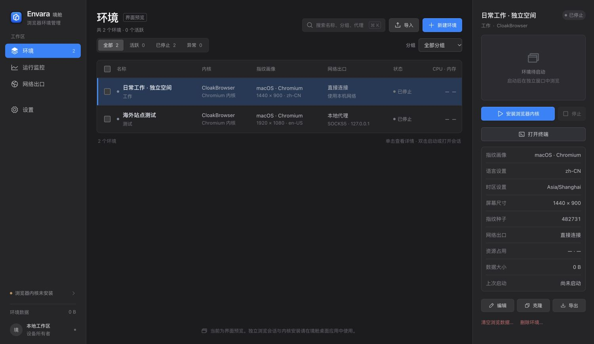

# Envara · 境舱

一个中文优先的浏览器环境桌面管理器。每个环境管理独立浏览资料、指纹、网络出口和终端工作区，在桌面应用内完成浏览器与命令行会话操作。

**Envara is an open-source desktop workspace for isolated browser environments.** The local 0.4.0 candidate adds app-managed AnyTLS routing to the multi-engine browser and terminal workspace.

[项目源码](https://github.com/ink-scholar/Envara) · [问题反馈](https://github.com/ink-scholar/Envara/issues) · [能力矩阵](docs/capability-matrix.md) · [架构说明](docs/architecture.md) · [验证记录](docs/verification.md) · [参与贡献](CONTRIBUTING.md)

上图为带「界面预览」标识的浏览器工作区预览，使用演示配置。0.3.0 保留三栏布局，底部终端默认高 360 px，可拖动或用键盘调整、放大/恢复，并可在独立窗口中使用。

## 当前状态

**0.4.0 本地开发候选版，尚未发布。** 既有源码仓库保持公开，安装发行版为草稿；新代码未推送，自动发布暂停。

本地后端基于固定的 BrowseForge v2.1.15（提交 fa9e0bb670e749706a9c8f2d4095333347d6c521），纳入 third_party/browseforge/ 并增加桌面补丁。应用管理私有本机服务，打包 sidecar、官方 Playwright driver/Node 与原生终端模块；最终安装包用户无需配置 Go 或 Node.js。

| 内核 | 按版本记录的原生证据 |
| --- | --- |
| CloakBrowser / Chromium | 0.3.0 macOS arm64 原生回归 11 项通过：手动身份、多环境隔离、Cookie/localStorage 持久化、认证 HTTP 代理和迁移；另有 3 项临时会话时区检查 |
| Camoufox / Firefox | 0.2.0 macOS arm64 官方安装及可见会话通过，可与 Chromium 同时运行；手动身份、跨内核隔离和 localStorage 重启保留通过。0.3.0 本轮尚未执行该内核 |
| BrowseForge Chromium | 0.2.0 macOS arm64 Alpha 0.1.6 单项安装、可见会话、手动身份、截图与停止通过；仍为实验性内核，0.3.0 本轮尚未执行 |

macOS Apple Silicon 是当前验证平台。0.4.0 的 **193/193** 项测试、19 项真实 AnyTLS 原生链、20 项包内 AnyTLS 检查及真实 PTY 验收通过。一条真实外部节点在本机 TUN 开启和用户主动关闭后均通过严格证书 HTTPS，并识别 Manila / Asia/Manila 出口，未使用 Clash 本地代理。原生 UI 已验证 ALPN/UDP 保存回读与失败提示，Mac .app/DMG/ZIP 资源和完整性已核对；当前包未签名且未公证，其余 GUI 与其他系统仍分别验收。范围见 [验证记录](docs/verification.md)。

## 0.4.0 内置 AnyTLS

应用管理独立的 Mihomo v1.19.32 进程，直接接收 AnyTLS 节点地址、端口、密码和 TLS 参数，无需另外运行 Clash 或手动提供本地代理端口。SNI 留空时使用节点主机，证书验证默认开启，客户端指纹默认 chrome；高级设置支持 ALPN 列表和默认开启的 UDP。私有 HTTP 入口不等于面向任意程序的通用 UDP 转发。

每个原始节点使用只绑定本机、带随机认证的私有入口。出口检测、浏览器和终端通过同一境舱上下文使用该节点；配置保留原节点绑定，不保存动态入口或运行认证。路由只指向选定节点，失败不转直连，不修改系统代理或开启 TUN。macOS 会只读识别物理出口接口供该核心使用；缺少可用接口时明确失败。支持代理变量的 CLI 才使用终端路由，localhost 仍按 NO_PROXY 直连。

当前只接入 AnyTLS；Mihomo 的上游协议清单不等于 Envara 已支持全部协议。应用原创代码与代理核心的许可分别保留，详见下方与第三方声明。

## 0.3.0 新增工作区能力

- **真实网络出口与时区：**通过配置的认证 HTTP、HTTPS 或 SOCKS5 代理发出 HTTPS 请求，读取实际出口 IP、粗略城市和 IANA 时区；不把代理入口地址当出口。配置变化会让相关检测缓存失效。
- **共用环境上下文：**浏览器与终端使用同一环境的网络、固定/自动时区解析规则。自动模式有代理时检测失败会拒绝启动；无代理时可明确使用本地时区回退，并显示来源。自动解析不会覆盖保存的手动配置。
- **每环境终端：**可折叠 xterm 面板连接真实 PTY，支持本地工作目录、可调高度、放大/恢复、独立窗口和同环境多会话。终端原生操作仅在桌面模式使用，Web 预览禁用。
- **独立工具配置与历史：**每环境拥有独立 HOME、XDG、Claude 配置目录和 shell 历史。不会直接继承宿主 API 密钥、SSH agent 或 shell/Node 启动钩子。

SOCKS5 环境为支持 HTTP 代理的 CLI 提供本机随机认证 HTTP 桥。代理变量只对支持它们的命令行工具生效；localhost 明确直连，不代表强制路由全部程序。Claude 配置路径已接入，Claude 本身的安装、登录和远端请求尚未测试。

复制终端会创建独立 PTY，沿用原会话启动时选择的工作目录、网络与时区；同一境舱共享工具配置和历史。它不追踪 shell 中手动 cd 后的目录，也不复制正在运行的命令或临时环境变量。折叠面板或关闭独立窗口只关闭视图，会话继续运行；「关闭会话」或退出应用才结束所属进程。

配置隔离仍使用同一个操作系统用户的权限，不是文件或进程沙箱。IP 地理定位只能估算地域，不能得到住宅街道地址；环境或账号隔离也不保证避免服务封禁。

## 本轮接入范围

- 环境创建、编辑、克隆、删除，分组、标签、搜索和批量操作。
- 独立持久化浏览器目录，会话启动、停止、聚焦和真实截图。
- 按内核能力配置种子或结构化指纹，手动指定系统画像、语言、时区和屏幕尺寸。
- HTTP、HTTPS、SOCKS5 代理、内置 AnyTLS 节点，以及分组代理策略。
- 配置导入导出、旧工作区备份与复制迁移。
- 上游的本机 REST、MCP、Playwright 连接与工作流能力；桌面入口和完整联动仍在验证。

原生后端的已通过项目见上表；分组、批量操作及其他桌面联动仍按 [验证记录](docs/verification.md) 分项验收。当前不能宣称已实现 BrowseForge 的完整功能对等。

0.3.0 的出口检查使用实际 HTTPS 请求，成功需得到有效公网 IP 与时区；失败不会伪造成功或转为直连。内置 VLESS 客户端、多人协作和云同步尚未实现；VLESS 等协议可由外部客户端提供 HTTP/SOCKS5 端口。指纹效果取决于内核、系统、字体、硬件和目标网站，Envara 不承诺通过所有检测站点。

## 本地开发

需要 Node.js **24 LTS** 或 **22.12+**、npm 和 Go **1.25+**。Go 仅用于从源码构建 sidecar；桌面运行使用准备好的 sidecar 和官方 Playwright driver 1.61.1 / Node。

~~~bash
npm ci
npm run desktop
~~~

desktop 会先验证原生 PTY、构建后端/driver，再运行 proxy:prepare 准备固定代理核心与对应源码，然后打开开发界面。首次准备需要联网；浏览器内核另由用户主动安装。原生模块不兼容时从源码重建，需要目标平台的编译工具。

构建后运行桌面应用：

~~~bash
npm run backend:prepare
npm run build
npm start
~~~

开发者可用 npm run dev 查看 Web 界面，Web 预览不能启动本机浏览器。基础检查：

~~~bash
npm test
npm run build
npm run test:sites
~~~

start 也会准备原生 PTY 和代理核心。test:sites 检查生成的文件，所以先运行 build；test:anytls 执行真实受控 AnyTLS 原生链，test:sidecar 覆盖浏览器服务，终端验收由 scripts/terminal-smoke.mjs 执行。最终结果见验证记录，当前没有公开正式 0.4.0 下载版。

## 旧工作区与配置导出

0.1.x 的 `workspace.json` 和 `profiles/<ID>/` 按**先备份、再复制**的方式迁移。源配置和浏览资料保持原样；默认复制选定环境的完整浏览资料，并记录旧 ID 到新 ID 的对应关系。迁移前需要停止旧会话；代理绑定和凭据在本机迁移中保留。本机原生测试已验证真实 Cookie/localStorage 复制、备份及原配置字节不变；其他机器、系统或个人环境仍需分别确认。

v2 配置导出包含指纹配置和脱敏后的代理描述与引用，不包含代理用户名、密码、Cookie 或浏览资料。导入有代理绑定的环境时必须明确映射到现有本地代理；缺少映射会取消导入，不会自动变成直接连接。配置导出不是浏览器备份。

运行资料保存在 Electron userData 下，新后端使用 browseforge/，迁移备份放在 migration-backups/。不要将用户目录、凭据或浏览资料提交到 Git。

## 技术与许可

Electron + React + Vite + Phosphor Icons，配合由应用管理的 BrowseForge Go 本地服务和 Playwright driver。浏览器二进制由用户主动从对应官方渠道安装，不随应用重新分发。

Envara 原创应用代码采用 [MIT](LICENSE)。纳入的 BrowseForge 代码保留 [MIT 许可证](third_party/browseforge/LICENSE) 和 [固定版本记录](third_party/browseforge/ENVARA_UPSTREAM.md)。独立 Mihomo 核心保留 [GPLv3](third_party/proxy-core/LICENSE)，资源准备同时提供对应源码与依赖 vendor 归属，见 [来源记录](third_party/proxy-core/SOURCE.md)。CloakBrowser 编译内核适用独立 [Binary License](https://github.com/CloakHQ/CloakBrowser/blob/main/BINARY-LICENSE.md)，不属于应用 MIT 授权。完整归属见 [THIRD_PARTY_NOTICES.md](THIRD_PARTY_NOTICES.md)。
