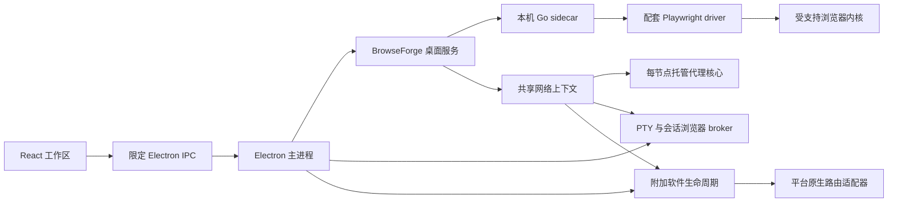

# Envara 0.5.23 架构

Envara 是本机单用户桌面工作区，组合浏览器环境、终端和附加软件。当前发布目标为 **macOS Apple Silicon（arm64）**；其他平台的构建入口不代表已经完成实机验收。功能范围见[能力矩阵](capability-matrix.md)。

## 进程与权限

渲染进程不直接访问 Node.js、任意文件路径或后端接口。主进程校验操作、目录选择权限和会话归属；本机 sidecar 使用私有令牌。宽权限后端令牌和原始浏览器 endpoint 不交给终端的会话级 MCP broker。

桌面先创建工作区窗口，再异步初始化服务。启动状态和失败可显示在窗口中，后台初始化不作为首窗出现的前置条件。服务未就绪时，相关操作等待或明确报错；退出会取消初始化并清理已创建的自有资源。

## 模块边界

| 模块 | 职责 |
| --- | --- |
| [主进程](../electron/main.mjs)、[启动](../electron/desktop-startup.mjs)、[IPC](../electron/desktop-ipc.mjs) | 窗口、启动状态、限定调用、文件对话框与服务接线 |
| [浏览器服务](../electron/browseforge-service.mjs)、[sidecar 生命周期](../electron/sidecar-manager.mjs) | 环境、分组、会话、内核安装及退出清理 |
| [网络检测](../electron/proxy-network.mjs)、[托管核心](../electron/proxy-core-manager.mjs)、[网络位置规则](../shared/network-location.mjs) | 认证出口检测、节点路由及已确认位置 |
| [终端服务](../electron/terminal-service.mjs)、[网络围栏](../electron/terminal-network-fence.mjs)、[浏览器 broker](../electron/terminal-browser-broker.mjs) | PTY、独立配置、进程清理与限定浏览器能力 |
| [附加软件服务](../electron/application-service.mjs)、[兼容性识别](../electron/application-compatibility.mjs) | 软件绑定、身份复核、运行和失败状态 |
| [导出格式](../electron/environment-export.mjs)、[数据恢复](../electron/environment-transfer.mjs)、[导入生命周期](../electron/environment-import-lifecycle.mjs) | 加密、范围校验、原子提交与可重试恢复 |
| [固定 BrowseForge 源码](../third_party/browseforge/ENVARA_UPSTREAM.md) | Go 浏览器后端与 Envara 接入补丁 |
| [macOS PF](../native/macos-pf-routing/gui-contract.md)、[Windows 路由](../native/windows-app-routing/README.md) | 各平台的原生协议、信任输入与验收边界 |

## 共享配置与路由

创建网络环境时测量认证后的实际出口，再确认位置与时区。浏览器、终端和附加软件复用此上下文；测得的出口与用户选择的模拟位置分别保存。细节见[网络环境](network-context.md)。

AnyTLS 原始配置只由桌面管理器保存；独立 Mihomo 核心提供节点专属的本机认证入口。浏览器启动时使用临时入口，永久 BrowseForge 档案与导出文件不保存动态监听凭据。受管档案缺少必要入口时，REST/MCP 启动同样拒绝。核心失效使出口缓存失效，不自动改为直连。

macOS 上使用托管回环路由的终端还受 Seatbelt 网络围栏约束。附加软件需要平台原生适配器，不能用代理变量代替接管。参见[附加软件路由](application-routing-options.md)和[Claude Code 会话](claude-code-sessions.md)。

## 数据与生命周期

数据保存在 Electron 的应用数据目录内。浏览器资料、终端 HOME/工具配置、命名 Claude 档案及每软件数据分别归属环境；用户选择的项目目录保持原地，不是复制品或文件系统沙箱。

- 克隆浏览器配置产生新的环境和种子，不复制原浏览器登录资料；既有环境保留自己的种子与设置。
- 关闭终端视图保留 PTY；结束会话才停止进程。复制终端创建同一上下文的新空闲进程。
- 附加软件停止、解绑和退出 Envara 保留登录与离线资料；清除数据或删除环境才删除相应资料。离线内容不作为通用缓存自动清理。
- 独立导出选择浏览器、单个 Claude 档案的终端资料或单个附加软件，以密码加密；导入创建新环境并要求明确代理映射。旧整环境导出仍可读取。
- 恢复冲突不覆盖非空目标；未完成回滚保留导入来源和恢复状态。旧工作区迁移保留原目录与备份。

复制 Cookie 或配置文件不证明跨机器登录可用；Keychain、真实账户认证和远程模型调用是独立边界。

## 构建与许可

后端、Playwright/Node、PTY 与代理资源由显式构建脚本准备，桌面用户无需系统 Go 或 Node.js。桌面模式使用随包的只读 driver，保留启动版本校验，不重复运行安装流程；资源缺失或不匹配时拒绝，不下载替代品。浏览器内核由用户按其各自许可获取，不作为通用安装包内置内核。固定版本与来源以[上游记录](../third_party/browseforge/ENVARA_UPSTREAM.md)、[driver 启动](../third_party/browseforge/internal/browser/manager.go)、[资源脚本](../scripts/prepare-playwright-driver.mjs)和[第三方声明](../THIRD_PARTY_NOTICES.md)为准。

Envara/BrowseForge 的 MIT 许可不替代 Mihomo 的 GPLv3、WinDivert 或浏览器二进制许可。源代码构建、包资源校验、真实路由、登录和发布验收分别执行；GitHub 自动编译和自动发布不启用。
