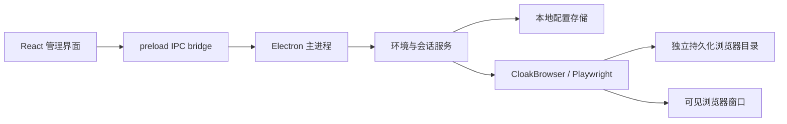

# Envara 架构

Envara 0.1.0 是本地单用户桌面应用。Electron 主进程负责磁盘、浏览器与系统操作；React 渲染进程负责管理界面。浏览器会话在独立的 CloakBrowser 窗口中打开。

## 代码边界

| 位置 | 职责 |
| --- | --- |
| `src/` | 三栏管理界面、环境表单、代理管理、监控与设置 |
| `electron/main.mjs` | 桌面窗口、IPC 调用、系统对话框和应用退出 |
| `electron/preload.cjs` | 通过 `contextBridge` 暴露限定的调用与状态订阅接口 |
| `electron/service.mjs` | 环境 CRUD、导入导出、会话生命周期与代理检查 |
| `electron/store.mjs` | 本地配置读取、校验和原子写入 |
| `electron/runtime.mjs` | 官方内核安装、指纹参数与持久化浏览器上下文 |
| `build/icon.png` | 桌面应用图标 |
| `worker/`、`.openai/` | Web 原型的 Sites 托管适配 |

渲染进程不直接访问 Node.js。IPC 经主进程限定的方法路由；错误以结构化结果返回。状态变化通过订阅传回界面，列表状态来自真实服务状态。

## 环境与浏览器数据

每个环境有独立 UUID、名称、分组、指纹参数和可选代理关联。首次启动会创建对应的 `profiles/<uuid>/` 数据目录，并通过 `launchPersistentContext` 启动可见浏览器。

- 同一环境再次启动复用自己的数据目录，保留网站数据。
- 不同环境使用不同数据目录。
- 克隆生成新 UUID、指纹种子和空白浏览器数据目录。
- 运行中的环境无法同时重复启动；停止会关闭对应上下文。
- 应用退出时关闭仍由 Envara 管理的浏览器上下文。

默认存储根目录是 Electron 的 `app.getPath('userData')`。macOS 为 `~/Library/Application Support/Envara/`。配置位于 `workspace.json`，浏览器内核缓存位于 `engines/`，不进入仓库或安装包。

配置通过临时文件、同步写入和重命名实现原子替换；文件以 `0600` 权限创建。数据文件损坏时保留原文件并报错，不覆盖为空工作区。

配置导出格式为 `{ schema: 'envara.profiles', version: 1, profiles: [...] }`，不包含浏览器存储、代理记录或许可密钥。导入先校验整批环境，再分配新的 UUID，保留种子并清除代理关联。它不是完整会话备份。

## 内核与指纹

首版只接入 CloakBrowser。JavaScript 包装层是 MIT 依赖，浏览器二进制遵循上游单独许可。用户在设置中主动安装，由官方分发渠道提供内核；自动后台更新关闭，避免无操作时改变运行基线。macOS 基线固定为 `145.0.7632.109.2`，Windows/Linux x64 基线为 `146.0.7680.177.5`。

指纹种子、画像系统、屏幕大小、语言和时区转换为内核支持的启动参数。存在代理时应用 Chromium 的 `disable_non_proxied_udp` WebRTC 策略；这不等同于保证所有 WebRTC 连接使用指定出口 IP。实际特征仍受上游版本、操作系统、字体和硬件影响，因此管理界面显示配置，不把配置当作所有网站已验证的检测结果。

## 代理与状态

代理配置支持 HTTP、HTTPS 和 SOCKS5。可用性检查使用 TCP 连接确认目标主机和端口可达，不进行代理认证或出口 IP 验证。VLESS 等传输需由用户自己的外部客户端转换成本地 HTTP/SOCKS5 代理。

会话状态来自持有的浏览器上下文。macOS/Linux 的资源数据来自 `ps` 对浏览器进程及其子进程的采样，内存采用 RSS 合计，共享内存可能重复计入。Windows 首版不提供该采样。无法获取的指标显示不可用；不生成示例 CPU、内存、出口 IP 或伪造的运行会话。

## Web 预览与桌面模式

Vite 提供 Web UI 预览。Web 环境不能启动本机浏览器，也不提供公网浏览器控制 API；会话操作要求 Electron 桌面桥接存在。

`npm run build` 同时生成 `dist/client/index.html`、`dist/server/index.js` 和 `dist/.openai/hosting.json`，保留原型的 Sites 交接能力。桌面打包使用本地渲染资源和 Electron 服务，浏览数据始终存放在运行设备的用户目录。

## 首版边界

没有多用户权限、团队共享、远程浏览器、同步服务或自动化公网 API。Windows 与 Linux 具有构建目标，实机运行状态需在各平台验收后记录。检测效果、平台支持和许可政策以实际测试与上游文档为准。
