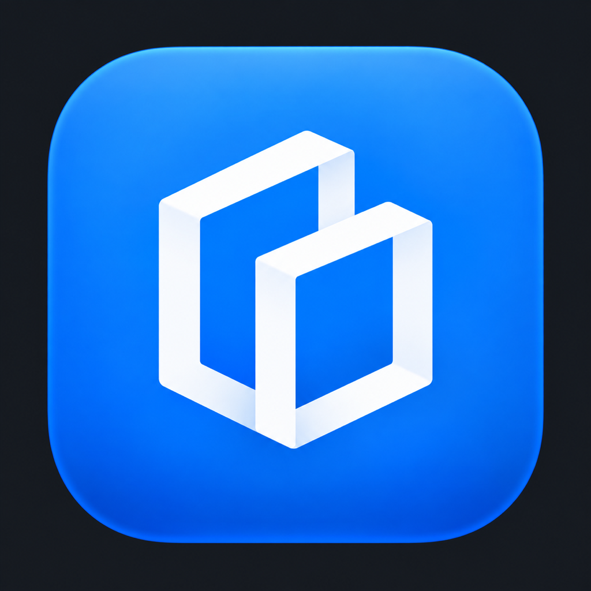
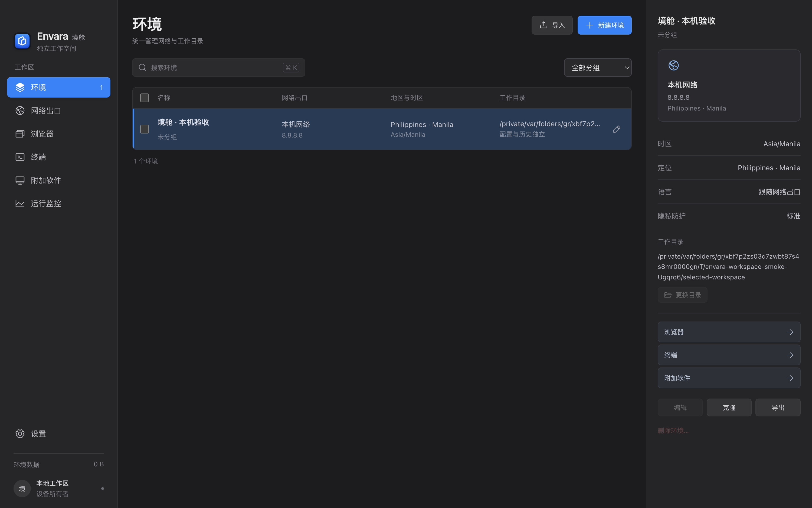
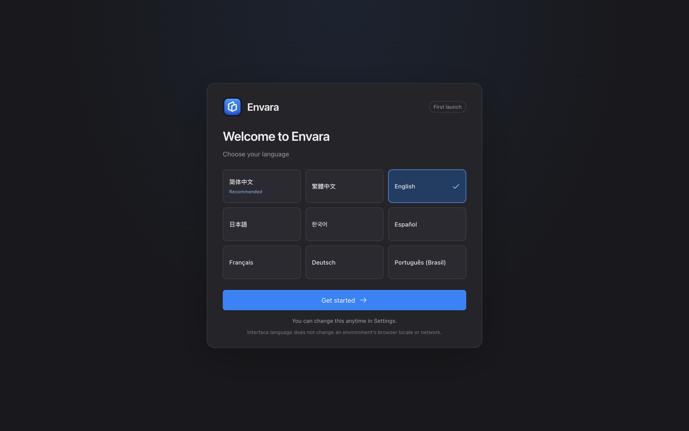

<p align="center">
  
</p>
<h1 align="center">Envara · 境舱</h1>
<p align="center"><strong>作業ごとに、独立したひとつの環境を。</strong><br />ブラウザーも、ターミナルも、アプリも。同じ作業環境で。</p>
<p align="center">
  <a href="../../LICENSE"></a>
  <a href="https://github.com/ink-scholar/Envara/releases"></a>
  <a href="en.md"></a>
</p>
<p align="center">
  <a href="../../README.md">简体中文</a> · <a href="zh-TW.md">繁體中文</a> · <a href="en.md">English</a> · <strong>日本語</strong> · <a href="ko.md">한국어</a> · <a href="es.md">Español</a> · <a href="fr.md">Français</a> · <a href="de.md">Deutsch</a> · <a href="pt-BR.md">Português (Brasil)</a>
</p>
<p align="center">
  <a href="https://github.com/ink-scholar/Envara/releases/latest">macOS 版をダウンロード</a> · <a href="../capability-matrix.md">機能と制限</a> · <a href="../../CONTRIBUTING.md">貢献する</a> · <a href="../SUPPORT.md">プロジェクトを支援</a>
</p>

**ブラウザーを開き、コマンドを実行し、デスクトップアプリにつなぐ。ひとつの作業環境で、流れを途切れさせずに。**

Envara は、ネットワーク出口、ブラウザープロファイル、ターミナルのツール、対応するデスクトップアプリをまとめる、オープンソースのローカルワークスペースです。環境ごとに設定とデータを保存し、プロジェクト、アカウント、地域に合わせた作業環境をひとつの画面で管理できます。



<p align="center"><sub>ネイティブ Electron ワークスペース。スクリーンショットには合成したサンプルデータを使用しています。</sub></p>

## Envara の特長：作業の流れをひとつにつなぐ

ブラウザーで調べ、ターミナルでコードを書き、デスクトップアプリで作業する。そのどれもが、同じプロジェクトの一部です。Envara なら、確認済みのネットワーク設定を共用しながら、ブラウザーデータ、ツール設定、アプリデータをそれぞれ引き継げます。

**ネットワークを一度選び、必要なツールをそろえたら、次回はその続きから。** 独立した環境を、日々の作業に自然に取り入れるためのワークスペースです。

### 🌐 環境ごとに、自分のブラウザーを

**CloakBrowser / Chromium、Camoufox / Firefox**、実験段階の **BrowseForge Chromium** から選べます。独立したブラウザーデータ、永続セッション、環境のグループ化、検索、設定の複製で、複数の作業環境を整理できます。設定を複製すると新しい環境が作られ、元のログインデータは元の環境に残ります。

フィンガープリントは選択したエンジンが既定で管理し、詳細設定ではデバイス、言語、タイムゾーンを指定できます。追跡ブロックには確認可能なルールを使用し、プライバシー制御の仕組みを把握できます。対応範囲はエンジンによって異なります。[ブラウザーとデバイス設定](../browser-device-profiles.md)

### 🧭 ネットワーク、位置、タイムゾーンを一度設定

**HTTP、HTTPS、SOCKS5、AnyTLS** に対応。AnyTLS はアプリに同梱した Envara 管理のプロキシコアを使うため、Clash を別途設定する必要はありません。

ネットワーク環境の作成時に、**プロキシ認証を経た実際の出口**を検出し、地域とタイムゾーンを確認します。ブラウザー、ターミナル、対応する追加アプリは、その設定を共用します。位置をシミュレートする場合は Google Maps で座標を選べ、測定した出口と設定した位置は区別して表示します。ホストのシステムタイムゾーンは変更しません。[ネットワーク環境](../network-context.md)

### ⌨️ ターミナルにも、独立した作業環境を

新しいセッションでは、**ネットワーク、リンクを開くブラウザー、プロジェクトフォルダー**を選択。設定と履歴は環境ごとに保存します。実際の PTY、複数セッション、高さを調整できるパネル、ワークスペースへの展開、独立ウィンドウで、コマンドラインも作業台の使いやすい一部になります。

ターミナルの複製では、同じ設定で新しい待機中のプロセスを作成します。パネルを閉じても、セッションに戻って作業を続けられます。対応する macOS の管理下ループバック経路にはネットワーク制限を適用し、プロキシ非対応のプログラムは接続に失敗するため、意図しない直接接続を防ぎます。プロジェクトフォルダーは元の場所にあり、使い慣れたツールチェーンを引き続き利用できます。

### 🧩 デスクトップアプリも、同じ作業の流れに

対応する **Chromium / Electron アプリ**に環境とリンク用ブラウザーを指定し、起動、停止、アプリデータをまとめて管理できます。Envara は対象アプリの識別情報、互換性、既存の実行インスタンス、ネイティブルーティングコンポーネントを確認し、条件を満たした場合にのみ起動を許可します。

停止、関連付けの解除、Envara の終了ではログイン情報とオフラインデータを保持し、次回も続きから利用できます。削除は必要なときに明示的に選択します。ネイティブルーティングにはシステムの承認が必要であり、対応エンジンであることは、すべてのアプリの検証完了を意味しません。[追加アプリの対応範囲](../application-routing-options.md)

### 🔗 コマンドラインからログイン画面まで、同じ環境で

環境のリンク用ブラウザーを指定すると、ターミナルから開くページを対応する環境で表示できます。macOS のシステムリンクルーティングは、管理対象アプリがシステムに渡すリンクも扱えます。環境に関係のないリンクは、これまでの既定ブラウザーで開きます。

システムリンクルーティングは macOS のダイアログで承認する必要があり、いつでも無効にできます。システムブラウザーを明示的に選んだ場合は、リンクが環境の外で開かれることを画面に表示します。

### 🤖 AI と自動化ツールにも、整理された作業台を

ブラウザーバックエンドは **REST、MCP、Playwright** インターフェースを提供し、ページ操作、フォーム、Cookie、スクリーンショットなどの自動化に利用できます。対応範囲は[機能一覧](../capability-matrix.md)をご覧ください。

Claude Code は、その統合機能のひとつです。環境ごとに**改変していない公式 CLI**を独立してインストールし、名前付きログインプロファイルを保存。セッション単位の MCP broker で、選択した環境のブラウザーに接続します。まず shell を開き、`claude` は利用者自身が起動します。モデル、セッションの再開、権限オプションも利用者が選べます。[Claude Code セッション](../claude-code-sessions.md)

### 📦 必要なデータだけを、次の環境へ

ブラウザー、ターミナル、追加アプリそれぞれの画面に、**パスワードで暗号化するエクスポート**を用意しています。ターミナルのエクスポートには、選択した Claude ログインプロファイルと、共通の shell 設定・履歴が含まれます。インポートでは新しい環境を作成し、既存のワークスペースを保持します。

プログラム本体、キャッシュ、一時ファイル、Keychain は含まれません。別の端末では、一部のアカウントに再ログインが必要です。

### 🗂️ 日々の管理を、できるだけスムーズに

ライト・ダーク・システム設定に合わせた外観を選べる 3 カラム画面に、環境、ネットワーク、ブラウザー、ターミナル、追加アプリ、実行状況を整理。外観の設定は Envara にのみ適用され、コンピューターの外観は変更しません。よく使う操作はすぐ手が届く場所に、細かな設定は詳細オプションにまとめています。9 種類の表示言語から、使い慣れた言語で始められます。

## Envara でできること

| 用途 | Envara でまとめて管理できるもの |
| --- | --- |
| 複数プロジェクトの開発 | プロジェクトフォルダー、ターミナルの設定と履歴、ブラウザーデータ、指定したネットワーク |
| 複数アカウントでの作業 | ブラウザーとアプリのデータを環境ごとに保存し、作業環境の混同を減らす |
| 地域ごとの Web ページ検証 | ネットワーク出口の選択と実測、ブラウザーの地域・言語・タイムゾーン設定 |
| AI 支援開発とブラウザー自動化 | 選択した環境でのツール実行、ブラウザーインターフェースへの接続、専用 Claude セッション |
| 作業環境のバックアップと移行 | ブラウザー、ターミナルプロファイル、個別アプリのデータを暗号化してエクスポートし、新しい環境で復元 |

**ローカルのデスクトップで、ひとつの作業環境を、さまざまなツールから。** 作業に集中できるよう、Envara が環境を整えます。

## ダウンロードとインストール

[GitHub Releases](https://github.com/ink-scholar/Envara/releases/latest) から **macOS Apple Silicon（arm64）** 向けの DMG または ZIP 形式のインストールパッケージをダウンロードしてください。DMG を開いたら、Envara を「アプリケーション」にドラッグします。チェックサムファイルとリリースノートは Release に付属します。

**現在の macOS 配布物は、Apple Developer ID による署名も公証も受けていません。** 初回起動時に macOS のセキュリティ確認でブロックされる場合があります。このリポジトリからダウンロードしたことを確認し、チェックサムを照合してください。Envara がシステムのセキュリティ確認を自動で無効にすることはありません。追加アプリ用のシステムルーティングコンポーネントには別途管理者の承認が必要で、ブラウザーや通常のワークスペースの起動時に自動インストールされることはありません。

| プラットフォーム | 今回の提供範囲 |
| --- | --- |
| macOS Apple Silicon | DMG、ZIP、SHA-256 チェックサムファイルを提供 |
| macOS Intel | ソースコードは維持していますが、検証済みの配布物は提供していません |
| Windows / Linux | 関連ソースコードは維持していますが、今回は配布物を公開しません。実機での検証範囲は機能一覧をご覧ください |

ブラウザーエンジンは、利用者がアプリ内のインストール機能から導入します。それぞれのライセンスが適用されます。デスクトップ実行に必要な依存関係はアプリに同梱しているため、Node.js や Go を別途インストールする必要はありません。

## 自分の言語で始める

**简体中文、繁體中文、English、日本語、한국어、Español、Français、Deutsch、Português (Brasil)** に対応しています。初回起動時にはシステム言語を推奨し、利用者が確認して選択します。その後は設定から切り替えられます。



<p align="center"><sub>ネイティブの初回起動時の言語選択画面。</sub></p>

インターフェースの言語とブラウザー環境の言語は別々です。メニューの言語を変えても、既存のネットワーク、タイムゾーン、作業ディレクトリは変わりません。

## 分離とプライバシーについて

Envara は、制御できるネットワーク、環境ごとに分けたデータ、確認可能なプライバシー機能を大切にしています。実際の機能に合わせて利用できるよう、次の点を明確にしています。

- 設定とデータの分離は、独立した OS ユーザー、Keychain、仮想ハードウェアを提供するものではありません。ブラウザーのフィンガープリント設定は、ネイティブアプリのハードウェア識別情報を変更しません。
- 対応する macOS ターミナルのルーティングにはネットワーク制限を使用します。この仕組みが未実装のプラットフォームや経路では、強制的に分離されているとはみなせません。詳しい範囲は[機能一覧](../capability-matrix.md)をご覧ください。
- 追加アプリで外側のネットワーク制限を使用する場合、Chromium/Electron の内部サンドボックスは無効になります。ネイティブコンポーネントの状態、対応エンジン、実際の検証範囲は区別して説明し、「識別できる」ことを「すべてのアプリを検証済み」とは扱いません。
- エクスポートには Keychain、プログラム本体、キャッシュ、一時ファイルは含まれません。別の端末では、一部のアカウントに再ログインが必要です。同じ端末で復元できても、別の端末でログイン状態を引き継げる保証はありません。
- 追跡のブロックは、実装済みのルールとエンジンが対応する制御に限られます。ネットワーク、アカウント、設定の分離はサービス側の制限の回避を保証せず、すべての追跡をなくすものでもありません。

[検証について](../verification.md) · [アーキテクチャ](../architecture.md) · [ネットワーク設定](../network-context.md) · [ブラウザーのデバイス設定と言語](../browser-device-profiles.md)

## ソースコードから開発する

Node.js 24 LTS（または 22.12+）、npm、Go 1.25、対象プラットフォームのビルドツールが必要です。macOS のネイティブコンポーネントには Xcode Command Line Tools が必要です。

```bash
npm ci
npm run desktop
```

初回の準備では、固定バージョンのビルド依存関係をダウンロードします。開発用プレビューとチェックは次のコマンドで実行できます。

```bash
npm run dev
npm test
npm run build
npm run test:sites
```

Web プレビューはインターフェース開発専用です。実際のブラウザー、PTY、システムルーティングにはデスクトップアプリが必要です。ビルドと公開については[貢献ガイド](../../CONTRIBUTING.md)と[リリース手順](../releasing.md)をご覧ください。GitHub の自動ビルド・リリースワークフローは無効のままで、ソースコードを push してもビルドは実行されません。

## オープンソースと支援

Envara の独自コードには [MIT](../../LICENSE) を適用します。BrowseForge は元の [MIT ライセンス](../../third_party/browseforge/LICENSE)と[固定バージョンの記録](../../third_party/browseforge/ENVARA_UPSTREAM.md)を保持しています。独立した Mihomo コアは [GPLv3](../../third_party/proxy-core/LICENSE)と[対応するソースコード](../../third_party/proxy-core/SOURCE.md)を維持しています。ブラウザーのバイナリにはそれぞれのライセンスが適用され、アプリの MIT ライセンスには含まれません。詳しい帰属は[第三者に関する通知](../../THIRD_PARTY_NOTICES.md)をご覧ください。

開発には多くの AI 利用費用がかかっています。Envara が役立った方は、任意でご支援いただけると幸いです：[USDT](../SUPPORT.md#usdt) · [USDC](../SUPPORT.md#usdc) · [Binance](../SUPPORT.md#binance)。Star、問題報告、翻訳やコードへの貢献も歓迎します。

[詳しい使い方（簡体字中国語）](../user-guide.md)
